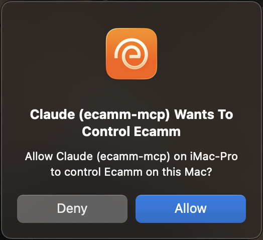

# ecamm-mcp

Run **Ecamm Live** from a chat with Claude. Type what you want in plain words and it happens.

"Am I ready to go live?" "Switch to my guest scene." "Show the lower third." "Drop a marker called Q&A."

It isn't a replacement for your Stream Deck. A button is still the fastest way to cut a scene on a beat. This is for what buttons can't do: checking your setup before a show, running several steps from one sentence, checking on your studio Mac from your phone, and anything you'd rather describe than program.

It uses Ecamm's own Remote Control feature, the same one Stream Deck and Companion use, so there is nothing to change in your Ecamm setup. It runs on your Mac and talks to Ecamm Live locally.

Community project. Not made by or affiliated with Ecamm Network.

## Install

You need a Mac with Ecamm Live and the [Claude desktop app](https://claude.ai/download). Pick one of the two ways below. Not both, or Claude will see everything twice.

### Option 1: no Terminal

1. Download **[ecamm-mcp.mcpb](https://github.com/guycochran/ecamm-mcp/releases/latest/download/ecamm-mcp.mcpb)**.
2. Double-click it. Claude opens. Click **Install**.
3. Open Ecamm Live, then ask Claude: **"What's my Ecamm status?"**
4. Ecamm Live asks for permission. Click **Allow**. Done.

### Option 2: one line in Terminal

Open Terminal (press Cmd+Space, type `Terminal`, press Return), paste this, press Return:

```bash
curl -fsSL https://raw.githubusercontent.com/guycochran/ecamm-mcp/main/install.sh | bash
```

That one line does everything:

1. Uses the Node.js you already have. If you have none, it downloads a private copy into `~/.ecamm-mcp`. No sudo, nothing installed system-wide.
2. Downloads the server into `~/.ecamm-mcp`.
3. Adds Ecamm to Claude desktop. Your existing Claude config is backed up first and nothing else in it is touched.
4. Opens Ecamm Live if it's closed and gets it to ask for permission. Click **Allow**.

Then quit Claude completely (Cmd+Q), open it again, and ask: **"What's my Ecamm status?"**

Run the same line again any time to update.

## The one click that matters

The first time Claude connects to Ecamm Live, Ecamm shows this. Click **Allow**. You only do it once per Mac.



Fastest way to get to this dialog: have Ecamm Live open, then either run the Terminal line above (it triggers the dialog and waits for you) or ask Claude "What's my Ecamm status?".

No dialog, or you clicked Deny by accident? In Ecamm Live go to **Settings > Remote Control** and tick **Claude (ecamm-mcp)**.

## Things to try

Type these into Claude. Use your own scene, overlay and sound names.

**Before the show**

- "Am I ready to go live?"
- "What scenes do I have?"
- "Show me a picture of all my scenes." Add "and refresh them" for current pictures; that switches through each scene.
- "Show me a thumbnail of the Interview scene." (current only for the scene you're on; see [Check your studio from your phone](#check-your-studio-from-your-phone))

**During the show**

- "Switch to Me + Guest."
- "Hide the logo overlay."
- "Mute the mic." / "Set sound effects to 60."
- "Play the applause sound."
- "Drop a marker: sponsor read starts."
- "Switch to the intro scene, play the applause sound, then switch to Me + Guest." (several steps, one sentence)

**The big buttons**

- "Go live on YouTube with the title Office Hours." (Say it plainly like this and it goes live. Anything less direct gets a preview of what it would do instead.)

Scenes, overlays, cameras, sounds and destinations all work by name. Part of a name is fine if it's unique. If two things match, it asks instead of guessing.

## Check your studio from your phone

You don't have to be at the Mac. If you use Claude on your phone and the Claude desktop app is open on the Mac that runs Ecamm, you can ask from wherever you are:

- "Is Ecamm ready for tonight's show?"
- "Send me a picture of every scene."
- "What's muted? What are my levels?"
- "Switch to the intro scene and send me what it looks like."

Claude answers with the status and sends the scene pictures into the chat. This was tested from the Claude phone app against a Mac running Ecamm: status, and a labeled sheet of every scene.

What you need to know:

- **The Mac has to be awake** with the Claude desktop app and Ecamm both open.
- **Phone-to-desktop is a Claude feature, not part of this project.** It needs a paid Claude plan. See Claude's guide: [Assign tasks from anywhere](https://support.claude.com/en/articles/13947068-assign-tasks-from-anywhere-in-claude-cowork).
- **Pictures are stills, not a live view.** Ecamm keeps one small thumbnail per scene and only refreshes it while that scene is on screen. A picture of a scene you're not on can be old.
- **By default the scene sheet changes nothing.** You get the pictures Ecamm already has, each marked current or possibly old.
- **Fresh pictures mean switching through every scene**, so you have to ask for that ("refresh them"). Anything fed from Ecamm, like a virtual camera, a Zoom call or a second display, will see each scene flash by, and scenes that start media will start it. It then returns to the scene you were on and tells you whether that worked.
- **It won't refresh while you're live, recording, starting or ending**, or when it can't tell. If someone changes the scene or starts a broadcast partway through, it stops and leaves things as that person set them.

## The pre-show check

Development branch: [recording and interview workflows](docs/RECORDING_WORKFLOWS.md) add intent-aware preparation and optional recording-file receipts. These are not yet part of the published release; separate-track setup and real-device validation remain manual.

Ask "am I ready to go live?" and you get one answer instead of a wall of settings. It flags what viewers would notice:

- Main output or mic muted, or mic at zero
- No streaming destination set up
- Preview Mode left on
- A broadcast or recording already running

It also tells you which scene you'll start on and which overlays are showing. It only reads. It never changes anything.

## It won't take you live by accident

| Tier | What | Behavior |
| --- | --- | --- |
| Read | Pre-show check, status, lists, thumbnails | Never changes anything |
| Show | Scenes, overlays, mutes, volumes, camera, sounds, markers, Zoom view controls | Runs right away |
| On-air | Go Live / Record / End, pause or split recording, public comments, switching Profiles, Zoom new / leave / end / mute all / record | **Only when you clearly ask for that exact action.** Otherwise it reports what it would do and stops |

To be clear about what that means: if you type "go live", it goes live without a second prompt. What it won't do is go live, end a broadcast or post publicly as a side effect of some other request.

Ecamm has one main button, and the same click starts or ends a broadcast depending on what the button says at that moment. So the server never "clicks the button". It is told where you want to end up: go live, record, or end.

- **Saying "go live" twice won't end your show.** The second request sees you're already live and does nothing.
- **"Go live" won't start a recording by mistake**, and "record" won't go live. If Ecamm is in the other mode, it says so and stops.
- **It won't click a button it can't read.** While Ecamm says Wait, shows its end-of-broadcast summary, or shows a label this tool doesn't know, nothing is clicked.
- **It reports what happened, not what it hoped.** After a click it watches Ecamm and says verified, failed, or unknown. On unknown it tells Claude to check before trying again.
- **One change at a time.** Requests that change Ecamm run in order, start to finish, so two of them can't trip over each other. Something else changing Ecamm at the same moment (you, a Stream Deck) can still happen; that's why results are read back.

Want Claude to look but not touch during a show? Turn on read-only mode: in the extension's settings, or `ECAMM_READ_ONLY=1` for the Terminal install.

## Something's not working

Terminal install: run this and read the output. Paste it when you ask for help.

```bash
~/.ecamm-mcp/ecamm-mcp doctor
```

| Problem | Fix |
| --- | --- |
| Claude doesn't know about Ecamm | Quit Claude completely (Cmd+Q, not just closing the window) and reopen it. |
| "Could not find Ecamm Live" | Open Ecamm Live. It has to be running. |
| "Waiting for approval" | Click **Allow** in Ecamm Live, or tick **Claude (ecamm-mcp)** in Settings > Remote Control. |
| It was working, then Ecamm restarted | Nothing to do. Ecamm picks a new port every launch and the server finds it again on the next request. |
| Every tool shows up twice | You installed both ways. Remove one: delete the extension in Claude, or run `~/.ecamm-mcp/ecamm-mcp uninstall`. |
| Ecamm asks for permission again | The saved ID in `~/.ecamm-mcp/client-uuid` was deleted. Click Allow again. |

To set it up again without reinstalling: `~/.ecamm-mcp/ecamm-mcp setup`

To remove the Terminal install: `~/.ecamm-mcp/ecamm-mcp uninstall`, then delete the `~/.ecamm-mcp` folder.

Still stuck? [Open an issue](https://github.com/guycochran/ecamm-mcp/issues).

## What it can do

| Tool | Does |
| --- | --- |
| `ecamm_preflight` | Pre-show check: ready or not, and what to fix |
| `ecamm_status` | Live or not, current scene, viewers, preview mode, mutes, volumes, Zoom state |
| `ecamm_list_scenes`, `ecamm_list_overlays`, `ecamm_list` | Scenes, overlays in the current scene, cameras, videos, sounds, audio filters, profiles, destinations |
| `ecamm_scene_sheet` | One labeled picture of every scene, plus a numbered list, from the thumbnails Ecamm already has. Changes nothing |
| `ecamm_refresh_scene_sheet` | Same sheet with current pictures: switches through every scene, then returns to where you were and says whether that worked |
| `ecamm_thumbnail` | Thumbnail of a scene, overlay or video |
| `ecamm_switch_scene`, `ecamm_step_scene` | Take a scene live by name, or next / previous |
| `ecamm_set_overlay` | Show, hide or toggle an overlay |
| `ecamm_set_overlay_text` | Update an existing text overlay while preserving styling; acceptance is reported, rendered text is not verified |
| `ecamm_set_mute`, `ecamm_set_volume` | Main mute, or any bus: mic, mic2, system audio, interview, zoom, sound effects, movie, guests 1 to 4 |
| `ecamm_set_camera`, `ecamm_set_source_mode`, `ecamm_play_video` | Camera input, camera / screen / video mode, play a video file |
| `ecamm_sound`, `ecamm_toggle_audio_filter` | Sound effects and audio filters |
| `ecamm_toggle` | PiP, Preview Mode, publish preview, hide UI, live demo |
| `ecamm_comment_overlay`, `ecamm_add_marker` | Show the latest comment on screen, drop a marker |
| `ecamm_start_stop` | Go live, record, or end, by stated intent (`go_live`, `record`, `end`). Verifies the result. Confirm required |
| `ecamm_recording` | Pause, resume, or split the recording. Confirm required |
| `ecamm_post_comment`, `ecamm_set_profile` | Post a public comment, switch Profile (confirm required) |
| `ecamm_zoom` | Ecamm for Zoom: view controls run directly, meeting controls need confirm |
| `ecamm_discover` | Find Ecamm Live again, or see which Macs on the network are running it |

Things it handles so you don't have to:

- **Toggles made safe.** Ecamm's mute and overlay commands only toggle. The server reads the state first, so "mute the mic" twice leaves it muted.
- **Scene switches are confirmed.** It waits until Ecamm reports the new scene before saying it's done.
- **Scene groups** are flattened and labeled `Group / Scene`.
- **Waits for your Allow click.** The first request holds for up to 25 seconds while you click Allow, so you don't have to ask twice.

## Compatibility and limits

- Overlays can only be read and controlled for the **current scene**.
- The only way to tell whether you're live is the main button's label (`New` or `Record` when idle, `Finish` when live or recording, `Wait` in between), which is what `ecamm_status` reports.
- **English labels only, for now.** Ecamm 4.6 added other languages. If your Ecamm isn't in English the button labels may differ, and this tool will then refuse to go live, end, or refresh scene pictures, because it won't act on a label it can't read. Status, scenes, overlays and audio are unaffected. Please open an issue with the labels you see.
- Ecamm documents this API in its [Automating Ecamm](https://support.ecamm.com/en/articles/17683976-automating-ecamm) help article. This project isn't made by Ecamm, so a future Ecamm update could still get ahead of it.
- A mute you set by hand may not survive a scene change. Seen once in testing; scenes appear to carry their own audio settings.
- **Marker persistence needs a new real-device test.** Earlier builds used a different endpoint from the one documented by Ecamm. The current source uses `setAddMarker`, also found in Ecamm's bundled Stream Deck plugin. The tool reports acceptance, not verified marker-file creation.
- **Overlay text updates need real-device verification.** `ecamm_set_overlay_text` uses the documented API to change an existing overlay, not create one. It does not change visibility and cannot read back the rendered text. Older Ecamm versions may not support it.
- A scene's thumbnail only updates while that scene is on screen, so a thumbnail of any other scene may be out of date.
- A bus that doesn't exist reports as unmuted.
- Picture-in-picture can be toggled, but Ecamm doesn't report whether it's on.

## Advanced

<details>
<summary>Ecamm on a different Mac, other MCP apps, settings, building from source</summary>

### How it finds Ecamm

- Ecamm **uses a new port every launch**, so the server looks it up each time instead of using a fixed port.
- **Same Mac (the normal case):** it finds Ecamm's port locally with `lsof` and connects over loopback. No Bonjour wait and no macOS Local Network permission needed.
- **Another Mac:** set `ECAMM_HOSTNAME` (or fill in "Ecamm on another Mac" in the extension settings). The server then uses Bonjour (`_ecammliveremote._tcp`). If that works in Terminal but not from Claude, allow Claude in System Settings > Privacy & Security > Local Network.
- If several Macs on the network run Ecamm, it picks **this Mac** first, then `ECAMM_HOSTNAME`, then a lone instance. It never guesses between two.

### Settings

| Variable | Use |
| --- | --- |
| `ECAMM_READ_ONLY=1` | Status and lists only |
| `ECAMM_HOSTNAME` | Target a specific Mac, e.g. `Mac-Mini-M2.local` |
| `ECAMM_HOST` | Skip discovery, `address:port` (the port changes per launch, so mainly for testing) |
| `ECAMM_CLIENT_NAME` | Name shown in Ecamm's Remote Control list |
| `ECAMM_APPROVAL_WAIT_S` | Seconds a request waits for your Allow click (default 25) |

For the Terminal install, add them under `"env"` in the `ecamm` entry of `~/Library/Application Support/Claude/claude_desktop_config.json`.

### Other MCP apps

Any MCP client that runs a local stdio server works. After the Terminal install the command is:

```bash
~/.ecamm-mcp/ecamm-mcp
```

Claude Code: `claude mcp add ecamm -- ~/.ecamm-mcp/ecamm-mcp`

To install without touching Claude desktop's config:

```bash
curl -fsSL https://raw.githubusercontent.com/guycochran/ecamm-mcp/main/install.sh | bash -s -- --no-claude
```

### From source

```bash
git clone https://github.com/guycochran/ecamm-mcp && cd ecamm-mcp
npm install && npm run build
npm run setup        # connect Claude desktop and bring up the Allow dialog
npm test
npm run package      # builds release/ecamm-mcp.mcpb and release/ecamm-mcp.cjs
```

Releases: bump the version in `package.json`, `src/version.ts` and `mcpb/manifest.json`, then push a tag like `v0.2.0`. GitHub Actions builds the extension and the single-file server and attaches them to the release.

</details>

## Tests

`npm test` runs unit tests plus an end-to-end run of the real MCP server against a fake Ecamm that reproduces the real response shapes, the toggle behavior, the scene-switch delay, the Allow flow, a relaunch on a new port, and loopback discovery. CI runs the same suite against the shipped bundle and runs `install.sh` on real Macs, with and without Node.js installed.

Against a real Ecamm Live, on versions 0.1.1 through 0.2.3, including an unlisted YouTube test broadcast: discovery, the Allow dialog, status, the pre-show check, all lists, thumbnails (including from a phone), scene switch and step, overlays, mute, volume, sound effects, camera, source mode, preview mode, the Zoom panel, going live and ending, a public chat comment, the comment overlay, splitting the recording, and the dry-run guard on Go Live, profile switch and Zoom end. Not yet run against a real Ecamm: pausing a recording, audio filters and video playback. If something behaves differently on your setup, please open an issue. Not yet run against a real Ecamm, and tested only against the simulator: the corrected marker and pause commands, overlay text, the system-audio and Zoom-sharing names, stricter command acknowledgements, the scene sheet and its refresh, go live / record / end by intent, and pause / resume by intent. The simulator's acknowledgement format is taken from Ecamm's documentation and has not been compared with a real Ecamm.

## Credits

Development notes: [API and Stream Deck research](docs/RESEARCH.md) and [Codex / Claude handoff](docs/CLAUDE_HANDOFF.md). The API corrections, overlay text, the scene sheet, broadcast intent and command ordering are simulator-tested only; see the handoff for the real-Ecamm checks still to do.

The scene sheet's label font is a bitmap rendered from DejaVu Sans Mono Bold, used under the DejaVu Fonts license. JPEG handling is jpeg-js (BSD-3-Clause).

API reference and response shapes from [bitfocus/companion-module-ecamm-live](https://github.com/bitfocus/companion-module-ecamm-live) (MIT), including its `docs/ecamm-live-remote-api-v4.4.md`.

Part of the Prodbots family, alongside the Resolve, ATEM, X32 and DMX servers. MIT licensed.
